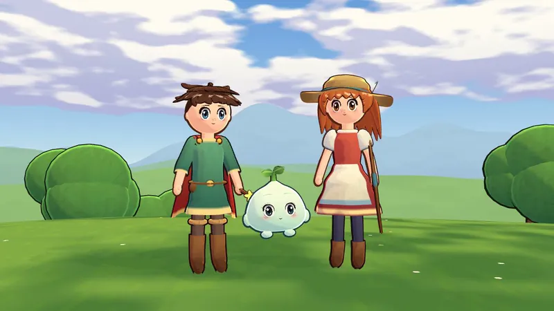
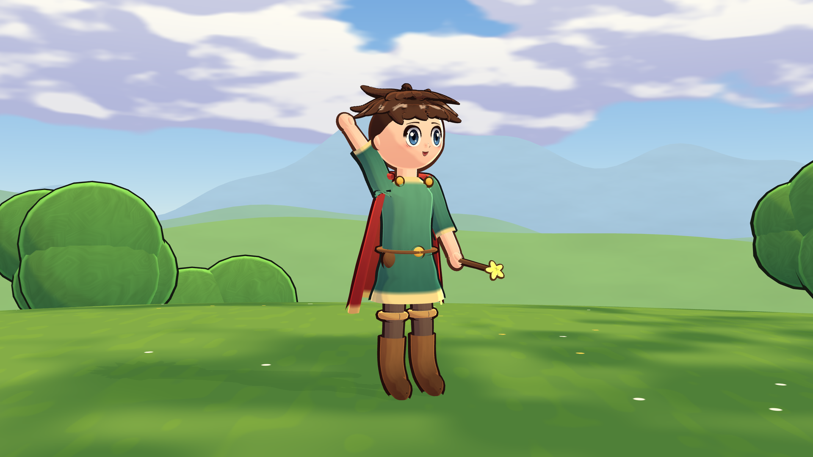
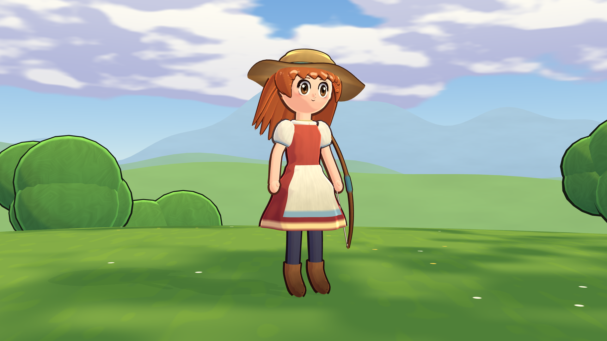
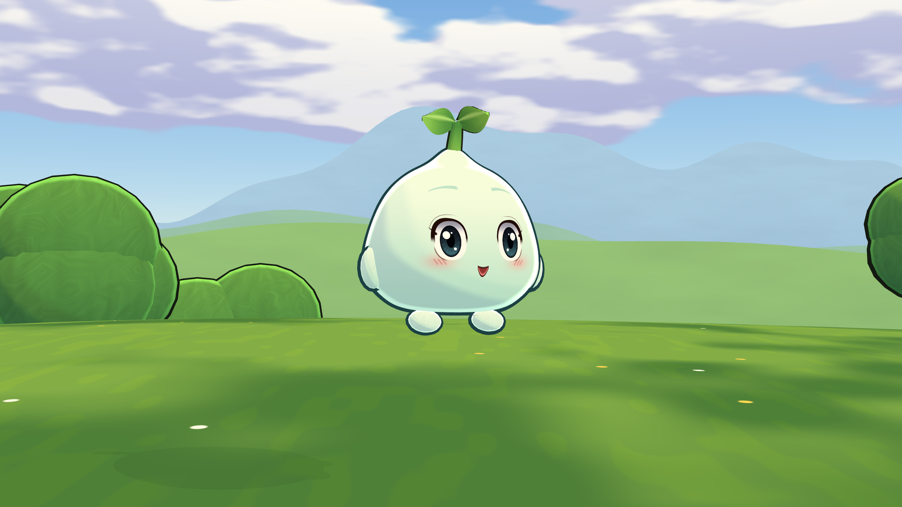
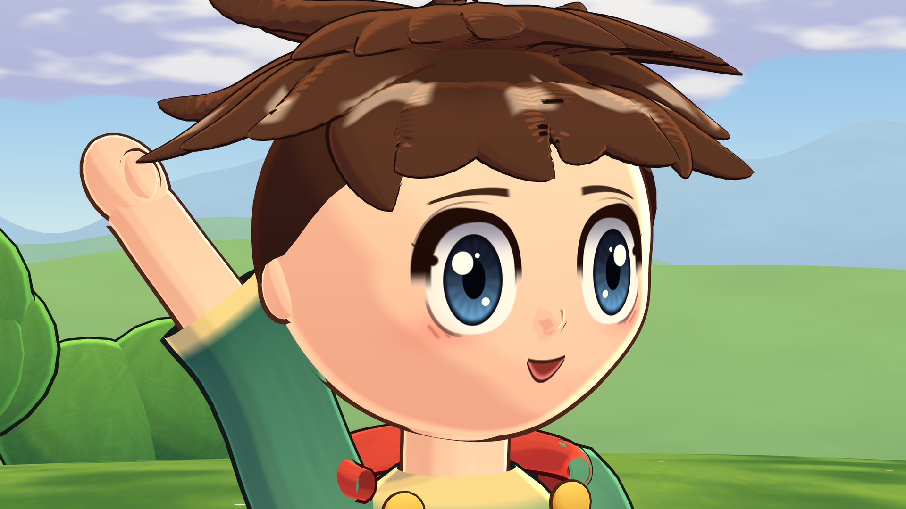
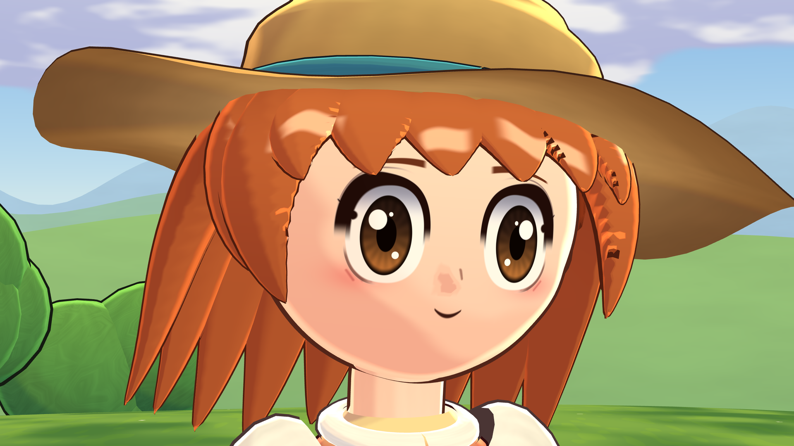
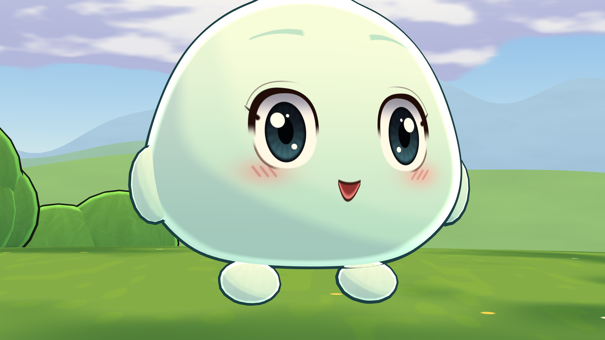
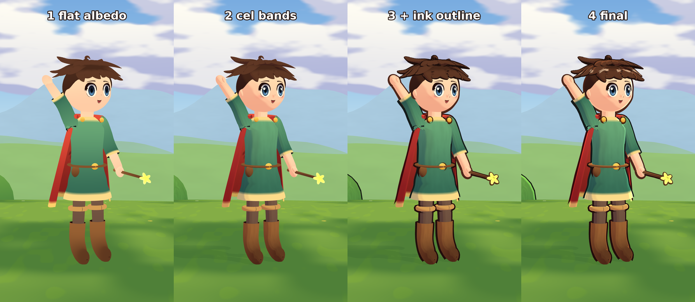

# Meadow Folk



Full-quality video: [media/toon_idle_720p.mp4](media/toon_idle_720p.mp4)

Meadow Folk is three original cel-shaded 3D characters in a painted hillside scene, inspired by the storybook anime look of games like *Ni no Kuni*. They are Pip, a boy adventurer with a cape and a star wand; Wren, a girl archer with a big traveller's hat and a bow; and Mochi, a small round leaf spirit. Everything is built in Godot 4.7.2 with **zero asset files**: the characters, their shader-drawn faces, the sky, the hills, the grass and the trees all come from about 1,650 lines of GDScript.

## Features

- Chibi proportions with skinned skeletons built from joint tables (`designs.gd`, `tchar.gd`)
- Big shader-drawn eyes and faces, with blinking (`thead.gd`, `tshaders.gd`)
- Banded cel shading and inverted-hull ink outlines
- Toon hair clumps (`thair.gd`)
- Idle animation: bounce, breathing, blinking, head drift, hair and cape springs, and a wave
- A painted set in code (`tscene.gd`): sky, rolling hills, grass, far ridges and trees
- A render driver with hero, face, group, movie and layer-breakdown modes (`main.gd`)

| Pip | Wren | Mochi |
|---|---|---|
|  |  |  |
|  |  |  |

How the shading builds up (flat albedo, cel bands, ink outline, final):



## How to run

You need [Godot 4.7.2](https://godotengine.org/download). The project uses the Compatibility renderer. The scripts below expect Linux with `xvfb-run` and `ffmpeg`, and the path to Godot in `GODOT`.

```bash
export GODOT=/path/to/godot-4.7.2

# render one still into out/
./run.sh 1920x1080 res://main.tscn --mode=hero --char=girl --out=hero_girl
#   --mode=hero|face|group|movie|breakdown|wire   --char=boy|girl|spirit   --stage=0..3 (breakdown)

# render all the stills and the breakdown strip into final/
./final.sh

# parse-check every script
./check.sh
```

You can also open the project in the Godot editor and run `main.tscn`.

## Tech notes

These numbers come from the final render logs (software OpenGL, no GPU):

| Character | Triangles | Build time |
|---|---|---|
| Pip | 69,168 | 0.64-0.71 s |
| Wren | 55,968 | 0.59-0.66 s |
| Mochi | 20,512 | 0.15-0.17 s |

- The median frame time for 2560x1440 stills was about 0.16-0.28 s per frame on the software renderer.
- About 1,650 lines of GDScript in 8 files.
- Honest limits: this isn't at studio quality yet. The bodies are a bit stiff, with mitten hands, the hair can look like ribbons, and there are a few small glitches in the outlines.

Idle clip: [media/toon_idle_720p.mp4](media/toon_idle_720p.mp4)

## Credits

- The characters are original designs. The look is inspired by *Ni no Kuni* (Level-5 / Studio Ghibli), and this project isn't affiliated with either.
- Inspired by the zero-asset approach of [The Ninth Vigil](https://github.com/iamlukethedev/The-Ninth-Vigil) by iamlukethedev (MIT). No code was copied from it.
- The code was written by an AI agent.
- Built with the [Godot Engine](https://godotengine.org).
